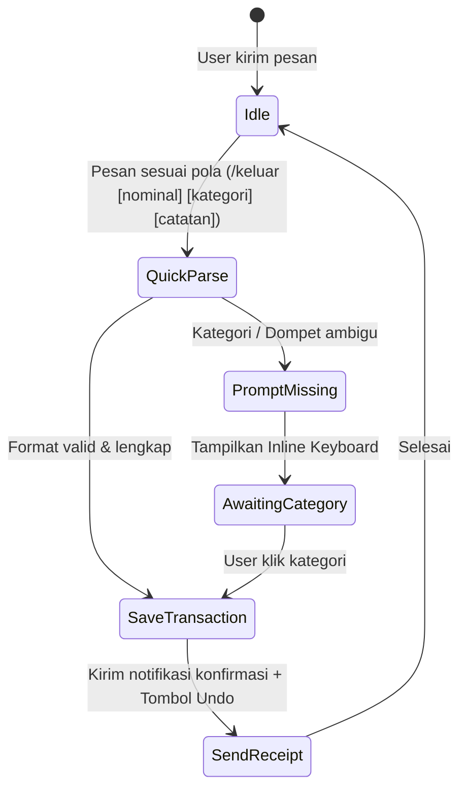

# BRD Generator Skill (Business Requirements Document)

Gunakan skill ini untuk menyusun Business Requirements Document (BRD) dan Product Requirements Document (PRD) yang terstruktur, komprehensif, dan siap diimplementasikan untuk proyek **Keuangan Kita** (Laravel + Telegram Bot + Vercel Serverless).

---

## 1. Filosofi & Pendekatan Produk Keuangan Kita

- **Frictionless Entry**: Mencatat pengeluaran/pemasukan harus kurang dari 5 detik via Telegram bot.
- **Data Accuracy & Integrity**: Nominal uang tidak boleh float/floating point. Menggunakan integer (dalam satuan Rupiah / sen) atau decimal(15,2).
- **Multi-channel Access**: Input cepat via Telegram Bot, visualisasi analitik & pengaturan mendalam via Web Dashboard Laravel.
- **Privacy & Security**: Isolasi data per pengguna (multi-tenant per user), autentikasi ketat, dan sanitasi input.

---

## 2. Struktur Standar Dokumen BRD

Setiap dokumen BRD yang dihasilkan wajib mengikuti outline standar berikut:

### I. Executive Summary & Problem Statement
- **Latar Belakang**: Alasan fitur/modul ini dibuat.
- **Problem Statement**: Masalah finansial spesifik yang dialami user (misal: sering lupa catat pengeluaran kecil, boncos di akhir bulan).
- **Target Outcome & Success Metrics (KPI)**:
  - Daily Active Users (DAU) & retention 30-hari.
  - Rata-rata waktu pencatatan transaksi (< 5 detik).
  - Error rate webhook / input parsing (< 1%).

### II. User Personas & Use Case Scenarios
- **Persona 1: Casual Spender (Pekerja / Mahasiswa)**
  - Kebutuhan: Catat kilat saat jajan via chat bot Telegram (`/keluar 25000 kopi susu`).
- **Persona 2: Family / Budget Conscious User**
  - Kebutuhan: Pantau sisa kuota amplop anggaran bulanan, peringatan over-budget.
- **Persona 3: Multi-Account Manager**
  - Kebutuhan: Pisahkan saldo dompet fisik (Cash), rekening bank (BCA/Mandiri), dan e-wallet (GoPay/OVO).

### III. Functional Requirements (FR)
Bagi FR ke dalam kategori yang jelas:

1. **Telegram Bot Interaction (FR-BOT)**
   - Perintah cepat: `/masuk`, `/keluar`, `/saldo`, `/kategori`, `/laporan`, `/budget`.
   - Natural language / flexible parsing: Contoh `keluar 50rb makan siang dompet gopay`.
   - Konfirmasi visual: Balasan pesan rapi dengan format Rupiah (`Rp 50.000`), kategori, dan tombol inline keyboard untuk *Undo* atau *Ubah Kategori*.
   - Multi-step conversational state (jika parameter tidak lengkap).

2. **Core Financial & Ledger Engine (FR-CORE)**
   - Manajemen Dompet / Akun (Wallets): Saldo awal, transfer antar dompet.
   - Manajemen Kategori: Tipe (Expense / Income), ikon, budget limit bulanan.
   - Transaksi: Nominal (IDR), dompet sumber, kategori, tanggal, catatan, attachment bukti struk (opsional).
   - Rekap & Laporan: Harian, mingguan, bulanan, per kategori, export CSV/Excel.

3. **Web Dashboard Laravel (FR-WEB)**
   - Autentikasi: Login / Register, integrasi Telegram Login Widget atau Magic Link via Bot.
   - Visualisasi: Chart pengeluaran mingguan/bulanan, progress bar limit budget.
   - Manajemen Data: Data table transaksi dengan pagination, filter tanggal/kategori, bulk delete/update.

### IV. Non-Functional Requirements (NFR)
- **Security & Authorization**: Proteksi IDOR (Insecure Direct Object Reference) dengan Laravel Policy.
- **Performance**: Response webhook Telegram wajib < 1.5 detik (menghindari timeout Telegram).
- **Reliability & Serverless Compatibility**: Stateless architecture, kompatibel dengan ephemeral environment Vercel (`/tmp/storage`).
- **Auditability**: Soft delete untuk transaksi dan log audit untuk penyesuaian saldo.

### V. Skema Entitas & Data Model (ERD)

Rancang relasi data dengan format tabel Markdown:

| Table | Kolom Kunci | Keterangan |
|---|---|---|
| `users` | `id`, `name`, `email`, `telegram_chat_id`, `telegram_username` | Akun utama pengguna |
| `wallets` | `id`, `user_id`, `name`, `type` (cash, bank, ewallet), `balance`, `currency` | Dompet / rekening |
| `categories` | `id`, `user_id`, `name`, `type` (income, expense), `icon`, `color` | Kategori pemasukan/pengeluaran |
| `transactions` | `id`, `user_id`, `wallet_id`, `category_id`, `type`, `amount`, `notes`, `transacted_at` | Catatan keuangan |
| `budgets` | `id`, `user_id`, `category_id`, `amount_limit`, `period_month`, `period_year` | Anggaran bulanan |
| `telegram_sessions`| `chat_id`, `current_step`, `payload`, `expires_at` | State machine obrolan bot |

### VI. Alur Telegram Bot (Conversational State Machine)
Gambarkan diagram alur interaksi bot menggunakan format Mermaid:

---

## 3. Cara Menjalankan Skill BRD Generator

Ketika user meminta pembuatan BRD untuk fitur baru:
1. **Identifikasi Ruang Lingkup**: Tanyakan apakah fitur berfokus pada Telegram Bot, Web Dashboard, atau Keduanya.
2. **Kumpulkan Aturan Bisnis Finansial**:
   - Apakah mempengaruhi saldo dompet?
   - Apakah mempengaruhi batas budget?
   - Format input yang didukung di bot.
3. **Generate Dokumen**: Buat dokumen Markdown lengkap di folder `docs/brd/` atau simpan sebagai proposal OpenSpec di `openspec/changes/`.
4. **Validasi Kesiapan Teknis**: Pastikan persyaratan dapat dijalankan pada arsitektur Vercel Serverless (tidak mengandalkan background daemon konvensional tanpa serverless worker / cron).
