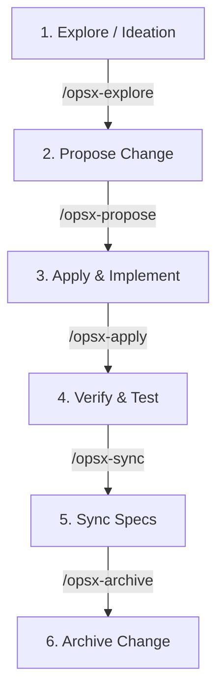

# OpenSpec Workflow Skill for Keuangan Kita

Skill ini adalah panduan terpadu siklus hidup pengembangan (End-to-End Workflow) menggunakan **OpenSpec** pada proyek **Keuangan Kita**. Mengatur transisi dari ide bisnis/BRD hingga implementasi kode Laravel, Telegram Bot, dan deployment Vercel.

---

## 1. Siklus Hidup OpenSpec (The 5 Phases)



| Fase | Command | Output Utama |
|---|---|---|
| **1. Explore** | `/opsx-explore` | Diskusi ide, analisis dampak database & bot UX, evaluasi edge-cases. |
| **2. Propose** | `/opsx-propose` | Berkas `proposal.md`, `specs/*.md`, dan `tasks.md` di `openspec/changes/<change-name>/`. |
| **3. Apply** | `/opsx-apply` | Implementasi kode (migration, model, service, controller, bot handler). |
| **4. Sync** | `/opsx-sync` | Sinkronisasi delta specs ke `openspec/specs/` utama. |
| **5. Archive** | `/opsx-archive` | Pengarsipan perubahan yang telah selesai dan lulus verifikasi. |

---

## 2. Struktur Change Artifacts untuk Keuangan Kita

Ketika membuat change baru untuk Keuangan Kita (misal: `add-wallet-transfer` atau `telegram-quick-expense`), pastikan artefak berisi:

### 1. `proposal.md`
- **Why**: Mengapa fitur ini dibutuhkan (contoh: user ingin memindahkan saldo antar dompet via bot).
- **What Changes**: Komponen yang disentuh:
  - Database migrations (tabel baru atau kolom baru).
  - Domain models & services (contoh: `TransferService` dengan database locking).
  - Telegram bot commands (contoh: `/transfer [dari] [ke] [nominal]`).
  - Web UI routes & controllers (jika ada tampilan web).
- **Impact & Risk**: Potensi race-condition saldo, timeout Vercel, kompatibilitas stateless storage.

### 2. `specs/*.md` (Delta Specs)
Menjelaskan kebutuhan spesifikasi formal dengan pola `ADDED`, `MODIFIED`, atau `REMOVED`:
```markdown
## ADDED Requirements

### Requirement: Atomic Wallet Transfer
Sistem wajib memindahkan saldo antar dompet secara atomik di dalam `DB::transaction()` dengan pessimistic locking (`lockForUpdate`).

#### Scenario: Sukses transfer antar dompet
- GIVEN user memiliki Dompet A dengan saldo Rp 100.000 dan Dompet B saldo Rp 0
- WHEN user melakukan transfer Rp 50.000 dari Dompet A ke Dompet B
- THEN saldo Dompet A menjadi Rp 50.000
- AND saldo Dompet B menjadi Rp 50.000
- AND tercipta 2 record transaksi bertipe `transfer_out` dan `transfer_in`

#### Scenario: Saldo tidak mencukupi
- GIVEN user memiliki Dompet A dengan saldo Rp 20.000
- WHEN user meminta transfer Rp 50.000
- THEN sistem melempar `InsufficientBalanceException`
- AND tidak ada saldo yang berkurang
```

### 3. `tasks.md` (Task Checklist)
Pecah tugas ke dalam unit terkecil yang dapat diuji:
```markdown
- [ ] 1. Database & Migrations
  - [ ] 1.1 Buat migration relasi transfer atau kolom `related_transfer_id` di tabel transactions
  - [ ] 1.2 Update model Wallet & Transaction relations
- [ ] 2. Business Logic & Service
  - [ ] 2.1 Buat `TransferService` dengan method `transfer(User $user, Wallet $from, Wallet $to, int $amount, ?string $notes)`
  - [ ] 2.2 Terapkan `lockForUpdate` dan validasi kepemilikan dompet
- [ ] 3. Telegram Bot Command
  - [ ] 3.1 Daftarkan parser `/transfer` di `TelegramBotHandler`
  - [ ] 3.2 Buat pesan konfirmasi inline keyboard
- [ ] 4. Automated Tests
  - [ ] 4.1 Unit test `TransferServiceTest` (scenario sukses & gagal saldo)
  - [ ] 4.2 Feature test Telegram Webhook untuk transfer
```

---

## 3. Best Practices OpenSpec pada Proyek Keuangan Kita

1. **Jaga Spec Selalu Sinkron dengan Kode**:
   - Jangan menulis kode tanpa spec terverifikasi.
   - Jika di tengah coding ada perubahan arsitektur (misal: format command bot disederhanakan), segera update delta spec.
2. **Perhatikan Batasan Serverless Vercel**:
   - Selalu pertimbangkan bahwa Vercel runtime memiliki batas execution time (10-15s pada free plan).
   - Jangan masukkan tugas yang membutuhkan background worker abadi (seperti `queue:work` konvensional); gunakan sync execution atau Vercel Cron Jobs.
3. **Validasi Sebelum Archive**:
   - Selalu jalankan `php artisan test` atau validasi manual endpoint sebelum mengeksekusi `/opsx-sync` dan `/opsx-archive`.
