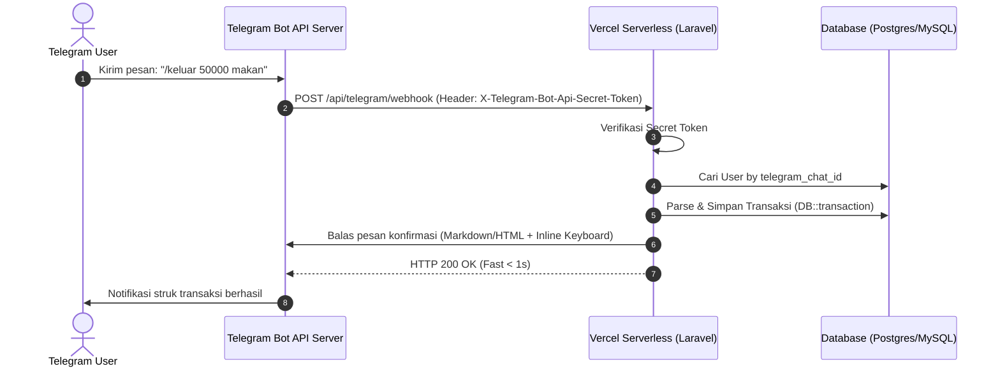

# Telegram Bot Handler Skill (Keuangan Kita)

Skill ini adalah panduan lengkap untuk merancang, mengimplementasikan, dan mengelola integrasi **Telegram Bot** pada aplikasi **Keuangan Kita** menggunakan framework Laravel dalam arsitektur Serverless (Vercel).

---

## 1. Arsitektur Webhook Serverless

Di lingkungan Vercel serverless, metode **Polling (getUpdates) TIDAK DAPAT digunakan** karena tidak ada worker background yang berjalan konstan. Kita **WAJIB menggunakan Webhook**.



---

## 2. Keamanan Webhook: Secret Token Verification

Untuk mencegah spoofing atau penyerang menembak endpoint webhook langsung:

1. Buat token rahasia acak (misal: string 32-karakter acak).
2. Daftarkan webhook ke Telegram dengan parameter `secret_token`:
   ```bash
   https://api.telegram.org/bot<TOKEN>/setWebhook?url=https://keuangan-kita.vercel.app/api/telegram/webhook&secret_token=<YOUR_SECRET_TOKEN>
   ```
3. Di Laravel Middleware, verifikasi header `X-Telegram-Bot-Api-Secret-Token`:

```php
namespace App\Http\Middleware;

use Closure;
use Illuminate\Http\Request;
use Symfony\Component\HttpFoundation\Response;

class VerifyTelegramWebhookSecret
{
    public function handle(Request $request, Closure $next): Response
    {
        $expectedSecret = config('services.telegram.webhook_secret');
        $incomingSecret = $request->header('X-Telegram-Bot-Api-Secret-Token');

        if (!$expectedSecret || !hash_equals($expectedSecret, (string) $incomingSecret)) {
            abort(403, 'Unauthorized webhook signature.');
        }

        return $next($request);
    }
}
```

---

## 3. Parsing Nominal Finansial Indonesia (Smart Amount Parser)

User Indonesia sering mengetik nominal dengan beragam format (`50k`, `50rb`, `50.000`, `50000`). Handler wajib dapat menguraikan nominal ini dengan cerdas:

```php
namespace App\Services\Telegram;

class AmountParser
{
    public static function parse(string $input): ?int
    {
        $cleaned = strtolower(trim($input));

        // Format 50k atau 50rb
        if (preg_match('/^(\d+(?:[\.,]\d+)?)\s*(k|rb|ribu)$/i', $cleaned, $matches)) {
            $val = (float) str_replace(',', '.', $matches[1]);
            return (int) round($val * 1000);
        }

        // Format 1.5jt atau 2jt
        if (preg_match('/^(\d+(?:[\.,]\d+)?)\s*(m|jt|juta)$/i', $cleaned, $matches)) {
            $val = (float) str_replace(',', '.', $matches[1]);
            return (int) round($val * 1000000);
        }

        // Format angka biasa dengan titik/koma (50.000 atau 50000)
        $digitsOnly = preg_replace('/[^\d]/', '', $cleaned);
        return !empty($digitsOnly) ? (int) $digitsOnly : null;
    }
}
```

---

## 4. Struktur Routing & Controller Webhook

### Route (`routes/api.php`)
```php
use App\Http\Controllers\TelegramWebhookController;
use App\Http\Middleware\VerifyTelegramWebhookSecret;

Route::post('/telegram/webhook', [TelegramWebhookController::class, 'handle'])
    ->middleware(VerifyTelegramWebhookSecret::class);
```

### Controller (`TelegramWebhookController.php`)
```php
namespace App\Http\Controllers;

use Illuminate\Http\Request;
use App\Services\Telegram\TelegramBotService;
use Illuminate\Support\Facades\Log;

class TelegramWebhookController extends Controller
{
    public function handle(Request $request, TelegramBotService $botService)
    {
        $update = $request->all();

        try {
            if (isset($update['message'])) {
                $botService->handleMessage($update['message']);
            } elseif (isset($update['callback_query'])) {
                $botService->handleCallbackQuery($update['callback_query']);
            }
        } catch (\Throwable $e) {
            Log::error('Telegram webhook error: ' . $e->getMessage(), ['trace' => $e->getTraceAsString()]);
        }

        // SELALU kembalikan 200 OK agar Telegram tidak mencoba mengirim ulang pesan secara agresif
        return response()->json(['status' => 'ok']);
    }
}
```

---

## 5. Daftar Perintah Bot & Format Respon

| Perintah | Contoh | Penjelasan |
|---|---|---|
| `/start` | `/start` atau `/start <link_token>` | Menyapa user & mengaitkan akun Telegram ke akun Web Keuangan Kita |
| `/keluar` | `/keluar 35000 Kopi Kenangan` | Catat pengeluaran kilat |
| `/masuk` | `/masuk 5000000 Gaji Bulanan` | Catat pemasukan kilat |
| `/saldo` | `/saldo` | Menampilkan ringkasan saldo seluruh dompet |
| `/laporan` | `/laporan` | Rekapitulasi pengeluaran & sisa budget bulan berjalan |
| `/help` | `/help` | Menampilkan panduan dan contoh format perintah |

### Format Template Notifikasi (HTML Format)
Gunakan mode `HTML` (bukan MarkdownV2) karena lebih mudah di-*escape* dan tahan terhadap error simbol khusus (`.`, `-`, `_`):

```php
$text = "<b>Catatan Pengeluaran Berhasil!</b>\n\n"
      . "💰 <b>Nominal:</b> Rp " . number_format($amount, 0, ',', '.') . "\n"
      . "🏷 <b>Kategori:</b> " . htmlspecialchars($categoryName) . "\n"
      . "👛 <b>Dompet:</b> " . htmlspecialchars($walletName) . "\n"
      . "📝 <b>Catatan:</b> " . htmlspecialchars($notes ?? '-') . "\n\n"
      . "<i>Sisa Saldo: Rp " . number_format($newBalance, 0, ',', '.') . "</i>";

// Mengirim tombol inline untuk Undo / Ubah Kategori
$keyboard = [
    'inline_keyboard' => [
        [
            ['text' => '🗑 Batalkan', 'callback_data' => 'undo_trx_' . $transactionId],
            ['text' => '🏷 Ganti Kategori', 'callback_data' => 'cat_trx_' . $transactionId],
        ]
    ]
];
```

---

## 6. Penanganan State Percakapan (Serverless-Friendly)

Karena filesystem Vercel sifatnya *ephemeral* (hilang setiap kali cold start), session multi-step percakapan (misal: bot bertanya "Silakan pilih kategori") **WAJIB** disimpan di Database atau Cache berbasis Redis/DB, BUKAN file session lokal:

- Gunakan tabel `telegram_sessions`:
  - `chat_id` (PK / Index)
  - `step` (misal: `waiting_category_selection`)
  - `payload` (JSON berisi data sementara)
  - `expires_at` (timestamp, misal 5 menit)
