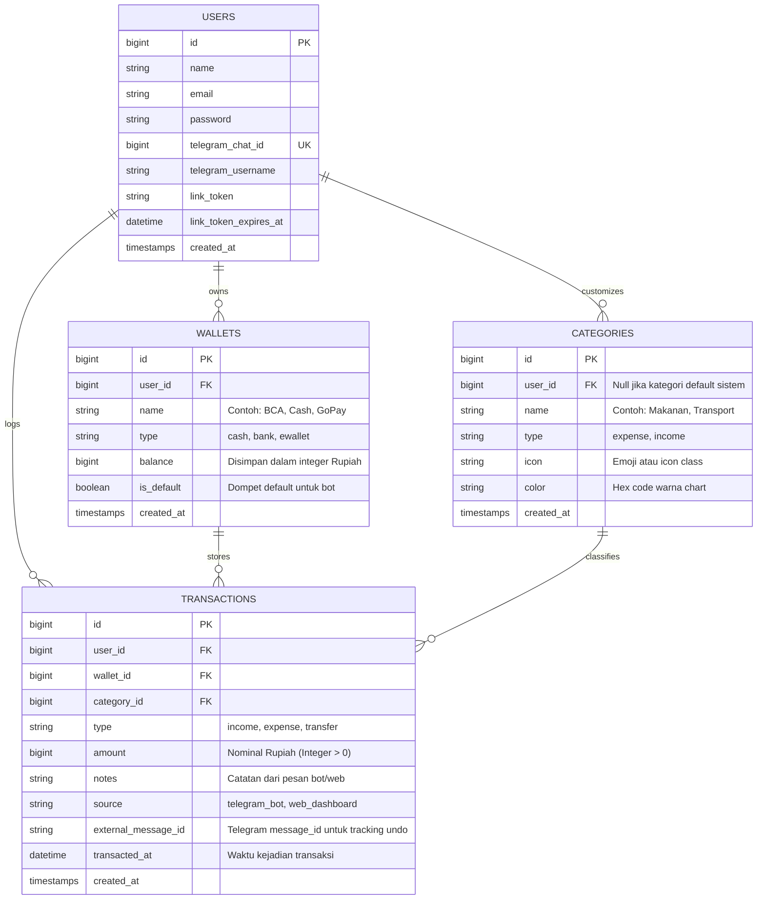

# Business Requirements Document (BRD)
## Proyek: Keuangan Kita (Financial Tracking via Telegram Bot & Web Dashboard)

- **Dokumen ID**: BRD-KK-001
- **Versi**: 1.0.0
- **Tanggal Efektif**: 15 Oktober 2026
- **Status**: Ready for Specification & Implementation
- **Tech Stack**: Laravel (Latest), Telegram Bot API (Webhook), Tailwind / Vanilla CSS + Chart.js, Vercel Serverless (PHP 8.2+), Managed PostgreSQL (Supabase / Neon)

---

## 1. Executive Summary & Problem Statement

### 1.1 Latar Belakang
Banyak individu dan keluarga gagal mengelola keuangan pribadi bukan karena ketiadaan niat, melainkan karena **friksi pencatatan**. Membuka aplikasi keuangan konvensional membutuhkan banyak langkah: membuka kunci HP, mencari aplikasi, menunggu loading splash screen, memilih dompet, memilih kategori, mengetik nominal, lalu menyimpan (rata-rata memakan waktu 20–30 detik). Akibatnya, pengeluaran kecil sehari-hari (kopi, parkir, jajan) sering terlewat dan memicu defisit di akhir bulan.

### 1.2 Problem Statement
- **Tingginya friksi input**: Pengguna malas mencatat pengeluaran mikro yang terjadi spontan.
- **Kurangnya transparansi sisa dana riil**: Pengguna tidak mengetahui sisa uang yang aman dibelanjakan (*safe-to-spend*) secara instan saat berada di kasir/toko.
- **Ketiadaan visualisasi tren berkala**: Pengguna membutuhkan evaluasi pengeluaran berkala (harian, mingguan, bulanan) tanpa harus mengekspor dan mengolah spreadsheet manual.

### 1.3 Solusi: Keuangan Kita
**Keuangan Kita** membagi pengalaman pengguna menjadi 2 pilar yang saling melengkapi:
1. **Telegram Bot (Input Kilat < 5 Detik & Cek Saldo Instan)**: Pengguna cukup mengirimkan chat pendek (contoh: `/catat 50000 makan siang` atau `/saldo`), sistem otomatis merekam nominal, kategori, dompet, serta waktu/tanggal secara *real-time*.
2. **Web Dashboard Laravel (Monitoring & Analitik Mendalam)**: Dashboard visual yang menyajikan grafik pemasukan vs pengeluaran harian, mingguan, dan bulanan, serta manajemen dompet dan kategori.

### 1.4 Target Key Performance Indicators (KPI)
- **Waktu Pencatatan**: $\le$ 3 detik dari pengiriman pesan bot hingga konfirmasi diterima.
- **Akurasi Timestamping**: 100% transaksi memiliki timestamp otomatis berbasis zona waktu pengguna (default: `Asia/Jakarta`).
- **Webhook Latency**: Waktu respon serverless Vercel $\le$ 1.2 detik untuk mencegah *retry storm* dari Telegram API.

---

## 2. User Personas & User Stories

### 2.1 Personas
1. **Andi (26 tahun, Karyawan Swasta)**
   - Perilaku: Menggunakan Telegram setiap hari untuk komunikasi kantor. Sering jajan kopi dan makan siang di luar.
   - Kebutuhan: Mencatat pengeluaran detik itu juga via bot Telegram tanpa buka aplikasi lain.
2. **Siti (31 tahun, Pengelola Keuangan Keluarga)**
   - Perilaku: Memerlukan evaluasi berkala untuk melihat pos anggaran apa yang membengkak di akhir pekan dan akhir bulan.
   - Kebutuhan: Melihat grafik pengeluaran mingguan dan bulanan di laptop/web dashboard, serta menerima notifikasi rekap bulanan otomatis via Telegram.

### 2.2 User Stories
- **US-01**: Sebagai pengguna, saya ingin mencatat pengeluaran/pemasukan lewat chat Telegram (`/catat 50000 makan`) sehingga pengeluaran saya langsung tercatat tanpa membuka website.
- **US-02**: Sebagai pengguna, saya ingin tanggal dan jam transaksi otomatis tercatat saat saya mengirim chat, sehingga saya tidak perlu memasukkan tanggal manual.
- **US-03**: Sebagai pengguna, saya ingin mengecek sisa saldo aktif (`/saldo`) melalui Telegram secara instan sebelum melakukan transaksi belanja.
- **US-04**: Sebagai pengguna, saya ingin menerima rekapitulasi keuangan bulanan melalui bot Telegram agar saya mengetahui total pengeluaran dan pemasukan pada bulan tersebut.
- **US-05**: Sebagai pengguna, saya ingin mengakses dashboard web untuk memonitor grafik tren keuangan harian, mingguan, dan bulanan beserta detail riwayat transaksi.

---

## 3. Functional Requirements (FR)

### 3.1 Modul Telegram Bot (FR-BOT)

| Kode FR | Deskripsi Kebutuhan | Aturan Bisnis & Logika |
|---|---|---|
| **FR-BOT-01** | **Pencatatan Cepat (`/catat`)** | Pengguna mengirim `/catat [nominal] [keterangan/kategori]`. Contoh: `/catat 50000 makan sate`.<br>- Jika tanpa tanda minus, sistem menganggap sebagai **pengeluaran**.<br>- Jika didahului tanda plus `/catat +500000 bonus` atau menggunakan alias `/masuk` dan `/keluar`, sistem menyesuaikan tipe transaksi.<br>- Sistem otomatis mendeteksi format singkatan Indonesia (`50k`, `50rb`, `50.000`). |
| **FR-BOT-02** | **Otomatisasi Tanggal & Waktu (Auto-Timestamp)** | Setiap transaksi yang dicatat via bot otomatis diisi dengan waktu server saat pesan diterima (`now()`) dengan timezone pengguna (WIB/WITA/WIT). |
| **FR-BOT-03** | **Cek Saldo Sisa (`/saldo`)** | Menampilkan total saldo gabungan seluruh dompet aktif dan rincian per dompet (misal: Kas Tunai, BCA, GoPay). |
| **FR-BOT-04** | **Rekap Bulanan On-Demand (`/laporan` atau `/rekap`)** | Menghasilkan ringkasan bulan berjalan: Total Pemasukan, Total Pengeluaran, Net Saving, dan Top 3 Kategori Pengeluaran Terbesar. |
| **FR-BOT-05** | **Rekap Bulanan Otomatis (Scheduled Notification)** | Dijalankan oleh Vercel Cron pada tanggal 1 setiap bulan (pukul 08:00 WIB), mengirim pesan rekap performa keuangan bulan sebelumnya ke seluruh pengguna aktif. |
| **FR-BOT-06** | **Pesan Konfirmasi Interaktif & Undo** | Setelah mencatat, bot membalas dengan struk ringkas disertai tombol inline keyboard `[🗑 Batalkan Transaksi]` yang berlaku selama 5 menit. |
| **FR-BOT-07** | **Account Linking (`/start <token>`)** | Mengaitkan ID Telegram (`chat_id`) dengan akun web Keuangan Kita melalui token unik sekali pakai yang digenerate di profil web. |

### 3.2 Modul Web Dashboard Laravel (FR-WEB)

| Kode FR | Deskripsi Kebutuhan | Aturan Bisnis & Logika |
|---|---|---|
| **FR-WEB-01** | **Monitoring Tren Harian** | Grafik batang/garis pengeluaran vs pemasukan 7 hari terakhir (Day-by-Day view). |
| **FR-WEB-02** | **Monitoring Tren Mingguan** | Agregasi pengeluaran per minggu dalam bulan aktif (Week 1 s/d Week 4/5). |
| **FR-WEB-03** | **Monitoring Tren Bulanan** | Grafik perbandingan pengeluaran vs pemasukan selama 6 hingga 12 bulan terakhir. |
| **FR-WEB-04** | **Donut Chart Komposisi Kategori** | Menampilkan persentase porsi pengeluaran berdasarkan kategori (Makanan, Transport, Hiburan, dll.). |
| **FR-WEB-05** | **Manajemen Transaksi (CRUD)** | Menampilkan tabel transaksi lengkap dengan pagination, filter tanggal, pencarian catatan, filter dompet, serta kemampuan edit/hapus manual. |
| **FR-WEB-06** | **Manajemen Dompet (Wallets)** | Menambah dompet baru (Bank, E-Wallet, Cash) dan mengatur dompet utama (*default wallet*) untuk input bot Telegram. |
| **FR-WEB-07** | **Manajemen Kategori (Categories)** | Mengatur daftar kategori pengeluaran dan pemasukan beserta ikon dan warna pembeda. |

---

## 4. Alur Interaksi & State Machine

### 4.1 Alur Pencatatan via Telegram Bot (Flowchart)

```mermaid
flowchart TD
    Start([User Kirim Pesan]) --> CheckAuth{Apakah Telegram Chat ID Terhubung ke Akun?}
    CheckAuth -- Tidak --> AskLink[Kirim Pesan: Silakan tautkan akun via Web Dashboard]
    CheckAuth -- Ya --> ParseMsg[Parse Command & Argumen]

    ParseMsg --> IsSaldo{Command == /saldo?}
    IsSaldo -- Ya --> FetchBalance[Ambil saldo dompet user]
    FetchBalance --> ReplySaldo[Kirim pesan ringkasan saldo]

    IsSaldo -- Tidak --> IsCatat{Command == /catat /keluar /masuk?}
    IsCatat -- Ya --> ExtractData[Ekstrak: Nominal, Kategori/Catatan, Auto-Timestamp now()]
    ExtractData --> ValidNominal{Nominal Valid?}
    ValidNominal -- Tidak --> ReplyHelp[Kirim contoh: /catat 50000 makan siang]
    ValidNominal -- Ya --> DBTrx[DB::transaction: Lock Wallet + Potong/Tambah Saldo + Insert Transaction]
    DBTrx --> ReplySuccess[Kirim struk konfirmasi + Tombol Undo]

    IsCatat -- Tidak --> IsRekap{Command == /laporan /rekap?}
    IsRekap -- Ya --> GenMonthlyReport[Kalkulasi data bulan berjalan]
    GenMonthlyReport --> ReplyReport[Kirim teks rekapitulasi bulanan]
    IsRekap -- Tidak --> UnknownCmd[Kirim bantuan command yang tersedia]
```

### 4.2 Contoh Format Percakapan Telegram Bot

#### 1. Input Transaksi Sukses
> **User:**
> `/catat 50000 Nasi Padang + Es Teh`
> 
> **Bot Keuangan Kita:**
> 🟢 **Pengeluaran Berhasil Dicatat!**
> 
> 💵 **Nominal:** Rp 50.000
> 🏷 **Kategori:** Makanan & Minuman
> 👛 **Dompet:** Dompet Utama (BCA)
> 📝 **Catatan:** Nasi Padang + Es Teh
> 📅 **Waktu:** 15 Okt 2026, 12:35 WIB *(Otomatis)*
> 
> 💳 **Sisa Saldo BCA:** Rp 1.450.000
> 
> `[ 🗑 Batalkan Transaksi ]` `[ 🏷 Ubah Kategori ]`

#### 2. Cek Saldo
> **User:**
> `/saldo`
> 
> **Bot Keuangan Kita:**
> 💼 **Ringkasan Saldo Anda**
> 
> 🏦 **BCA:** Rp 1.450.000
> 📱 **GoPay:** Rp 215.000
> 💵 **Tunai (Cash):** Rp 85.000
> ━━━━━━━━━━━━━━━━━━━
> 💰 **Total Saldo:** **Rp 1.750.000**
> 
> *Gunakan `/catat [nominal] [ket]` untuk menambah transaksi baru.*

#### 3. Rekap Bulanan
> **User:**
> `/rekap` (atau terkirim otomatis di awal bulan)
> 
> **Bot Keuangan Kita:**
> 📊 **Rekapitulasi Keuangan — Oktober 2026**
> 
> 📈 **Total Pemasukan:** Rp 8.500.000
> 📉 **Total Pengeluaran:** Rp 4.120.000
> ━━━━━━━━━━━━━━━━━━━
> 💵 **Net Tabungan:** +Rp 4.380.000 (Surplus)
> 
> 🏷 **Top 3 Pengeluaran Terbesar:**
> 1. Makanan & Minuman: Rp 1.850.000 (45%)
> 2. Transportasi: Rp 820.000 (20%)
> 3. Belanja Bulanan: Rp 750.000 (18%)
> 
> 🌐 *Lihat grafik visual lengkap di Web Dashboard Keuangan Kita.*

---

## 5. Skema Data & Model Entitas (Database Schema)

Aplikasi menggunakan skema relasional terstandar di PostgreSQL / MySQL.



---

## 6. Non-Functional Requirements (NFR)

1. **Keamanan Finansial & Sanitasi**:
   - Nominal saldo dan transaksi **WAJIB** berupa `BIGINT` (Rupiah utuh) untuk mencegah cacat pembulatan floating point.
   - Operasi saldo wajib di dalam `DB::transaction()` dengan pessimistic locking `lockForUpdate()`.
   - Autorisasi IDOR: Seluruh query data di web dan bot disaring melalui `user_id`.
2. **Kesesuaian Arsitektur Serverless Vercel**:
   - Endpoint webhook Telegram (`/api/telegram/webhook`) harus segera merespon `200 OK` dalam waktu $< 1.5$ detik.
   - Tidak menggunakan *session file storage* lokal; sesi dialihkan ke database/cache.
   - Penyimpanan sementara (compiled views, config cache) dialihkan ke `/tmp/storage`.
3. **Webhook Security**:
   - Telegram Bot API mengirim header `X-Telegram-Bot-Api-Secret-Token`. Request ditolak (`403 Forbidden`) jika rahasia tidak cocok.

---

## 7. Rencana Rilis Fitur (Implementation Roadmap via OpenSpec)

Pengembangan akan dipandu menggunakan skill **`openspec-workflow`**:

- **Milestone 1 (Foundations & Schema)**: Inisialisasi Laravel, konfigurasi runtime Vercel (`vercel.json`, `api/index.php`), skema database User, Wallet, Category, Transaction.
- **Milestone 2 (Telegram Bot Webhook Engine)**: Handler webhook, verifikasi secret token, amount parser (`50k`, `50rb`), command `/catat`, `/saldo`, dan auto-timestamping.
- **Milestone 3 (Web Dashboard Monitoring)**: Halaman dashboard analitik harian, mingguan, bulanan dengan visualisasi chart responsif dan filter rentang waktu.
- **Milestone 4 (Monthly Recap & Automations)**: Command `/laporan` on-demand dan penjadwalan Vercel Cron untuk rekap bulanan otomatis.
- **Milestone 5 (Polish & Security Hardening)**: Penerapan rate limiter, tombol interactive Undo, dan verifikasi akhir sebelum deployment production.
